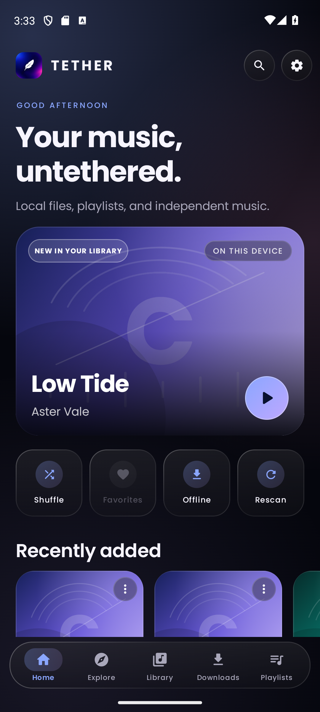
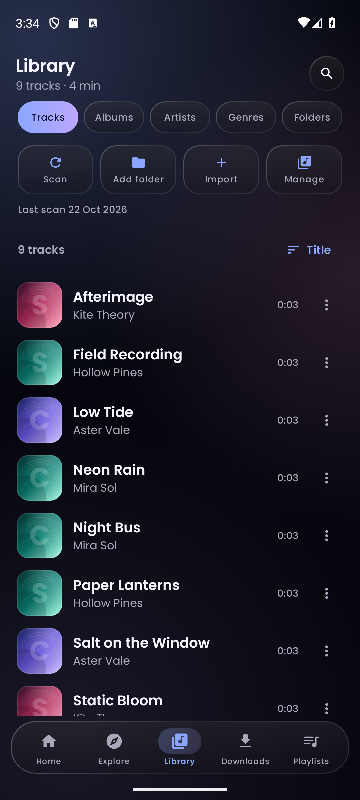
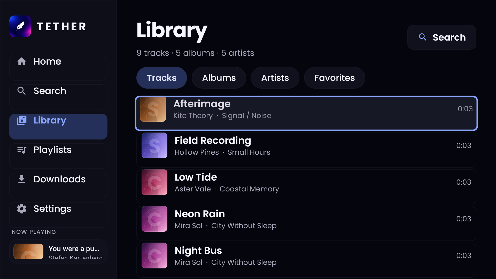

# Tether

**Music, untethered.** Tether is a local-first music player for Android and Android TV. It plays the music already on your device, opens folders through the system picker, and can discover openly licensed music from ccMixter. No account, no ads, and no invented streams or lyrics.

Tether comes as two separate apps. Each install keeps its own on-device library, favorites, playlists, settings, and playback state. Nothing is synced between the phone and the TV.

| App | Package | Minimum Android |
| --- | --- | --- |
| **Tether Mobile** | `dev.tether.music` | Android 8.0 (API 26) |
| **Tether TV** | `dev.tether.tv` | Android TV 8.0 (API 26) |

## Download

Grab the APKs from the [latest GitHub release](https://github.com/virusdeflect21/Tether/releases/latest):

- `tether-mobile-release.apk` - phone / tablet
- `tether-tv-release.apk` - Android TV / Google TV

Checksums are in [SHA256SUMS](SHA256SUMS) and are attached to the release.

Install over ADB:

```bash
adb install -r tether-mobile-release.apk
adb install -r tether-tv-release.apk
```

Enable "Install unknown apps" if you install directly on the device. The TV app appears in the Android TV leanback launcher.

## Screenshots

| Mobile | TV |
| --- | --- |
|  |  |
|  |  |
|  |  |

More: [mobile search](screenshots/mobile-search.png), [mobile downloads](screenshots/mobile-downloads.png), [mobile playlists](screenshots/mobile-playlists.png), [TV screensaver](screenshots/tv-screensaver.png).

Screenshots use short local test tracks, including one CC BY-NC 4.0 track from ccMixter. Artwork shown here is generated locally.

## What it does

### Both apps

- **Local playback** through Android Media3/ExoPlayer, with a background `MediaSessionService`, notification controls, and lock-screen controls.
- **Library scanning** with MediaStore and the Storage Access Framework. Add a folder or import individual files; nothing is uploaded.
- **Albums, artists, tracks, favorites, and search** over the real local library.
- **Playlists** with create, rename, delete, add/remove tracks, and M3U import.
- **Queue management**, shuffle, repeat, seek, and resume-state persistence.
- **Lyrics** from LRCLIB or an imported `.lrc` file. Synced, plain-text, and unavailable states are shown honestly. Plain lyrics are never animated as if they were timed.
- **Downloads** only when the provider declares a license that explicitly permits downloading (Creative Commons, public domain, or sampling+). Attribution and license remain with the track. No DRM bypass and no guessed download URLs.
- **Themes**: dark, light, or system, with the Tether blue/violet/magenta accent or a custom accent.
- **Metadata and artwork** from local tags and embedded artwork, with generated fallback covers.
- **Poppins typography** bundled under the SIL Open Font License.

### Tether Mobile

- Portrait-only Home, Explore, Library, Downloads, Playlists, and Search.
- Full player with artwork, synchronized/plain lyrics, editable queue, favorite and add-to-playlist actions.
- Mini-player that stays above the bottom navigation.
- Folder picker, multi-file import, M3U import, and M3U export.
- Sleep timer, backup, storage diagnostics, settings, About, and open-source notices.
- Accessibility labels and honest empty states throughout.

### Tether TV

- Landscape, D-pad-first UI with a visible focus ring on every actionable element.
- Sidebar navigation: Home, Search, Library, Playlists, Downloads, and Settings.
- Now Playing with three modes: **Cover**, **Lyrics**, and **Video**.
- Switching modes never restarts playback. Video mode attaches a local video file, plays it muted on a second ExoPlayer, and keeps it synchronized with the audio.
- Screensaver with the clock, current track, and artwork. A remote key dismisses it.
- Startup screen preference (Home or Now Playing), lyrics size, artwork scale, and screensaver timeout.
- M3U playlist import and licensed downloads.

## Content policy

Tether never fabricates media. If the local library has no match and an online provider is unreachable, the app says so. If the provider does not return a stream, the track is not playable. If a license does not allow downloads, the download action is unavailable and the reason is shown.

The only online music provider currently enabled is **ccMixter** (`https://ccmixter.org`). Lyrics come from **LRCLIB** (`https://lrclib.net`). Artwork may be loaded from the URLs published by those services. Internet Archive support is not shipped.

Downloaded files are stored in the app's external files directory under `Tether downloads`. Keeping attribution with shared files is the user's responsibility; noncommercial licenses are for personal listening.

## Privacy

- No account, analytics, advertising ID, or telemetry.
- Listening history, playlists, favorites, and settings stay in each app's local database/DataStore.
- Network requests happen only for provider search, lyrics lookup, artwork, and user-requested downloads.
- The app does not upload the local library.

See [PRIVACY.md](PRIVACY.md) for details.

## Build from source

Requirements: JDK 21, Android SDK 36, Android Studio or the command-line SDK.

```bash
# Windows
set JAVA_HOME=C:\Program Files\Android\Android Studio\jbr
set ANDROID_HOME=%LOCALAPPDATA%\Android\Sdk
gradlew.bat :tether-mobile:assembleDebug :tether-tv:assembleDebug

# macOS / Linux
JAVA_HOME=/path/to/jdk21 ./gradlew :tether-mobile:assembleDebug :tether-tv:assembleDebug
```

Release builds:

```bash
./gradlew :tether-mobile:assembleRelease :tether-tv:assembleRelease
```

Outputs:

- `tether-mobile/build/outputs/apk/release/tether-mobile-release.apk`
- `tether-tv/build/outputs/apk/release/tether-tv-release.apk`

Run unit tests with `./gradlew test`.

> The published 1.0.0 APKs are signed with the repository's development key so they can be sideloaded. Replace the signing configuration with your own release key before distributing through an app store.

## Project layout

```
core/model       domain models, settings, formatting
core/database    Room entities, DAOs, migrations
core/data        library, scanning, search, providers, playlists, backup, diagnostics
core/downloads   permission checks, resumable downloads, WorkManager integration
core/player      MediaSessionService, ExoPlayer queue, playback state
core/lyrics      LRCLIB client, LRC/embedded lyric parsing
core/design      brand theme, artwork, shared Compose components
tether-mobile    phone/tablet Compose app
tether-tv        Android TV Compose app
```

## Known limitations

- Internet Archive is not included; only ccMixter is available for online discovery.
- TV video mode requires a local video file selected with the system picker. It is a companion video track, not a video streaming provider.
- Phone and TV libraries, favorites, playlists, settings, and playback sessions are separate. Install and set up each app independently.
- The release APKs use a development signing key, not a production app-store key.
- Online availability depends on the provider being reachable from your network.

## License

Tether's source code is released under the MIT License. See [LICENSE](LICENSE) and [NOTICE.md](NOTICE.md) for third-party components and brand assets. The bundled Poppins font is licensed under the SIL Open Font License 1.1; the full text is in [licenses/Poppins-OFL.txt](licenses/Poppins-OFL.txt).
